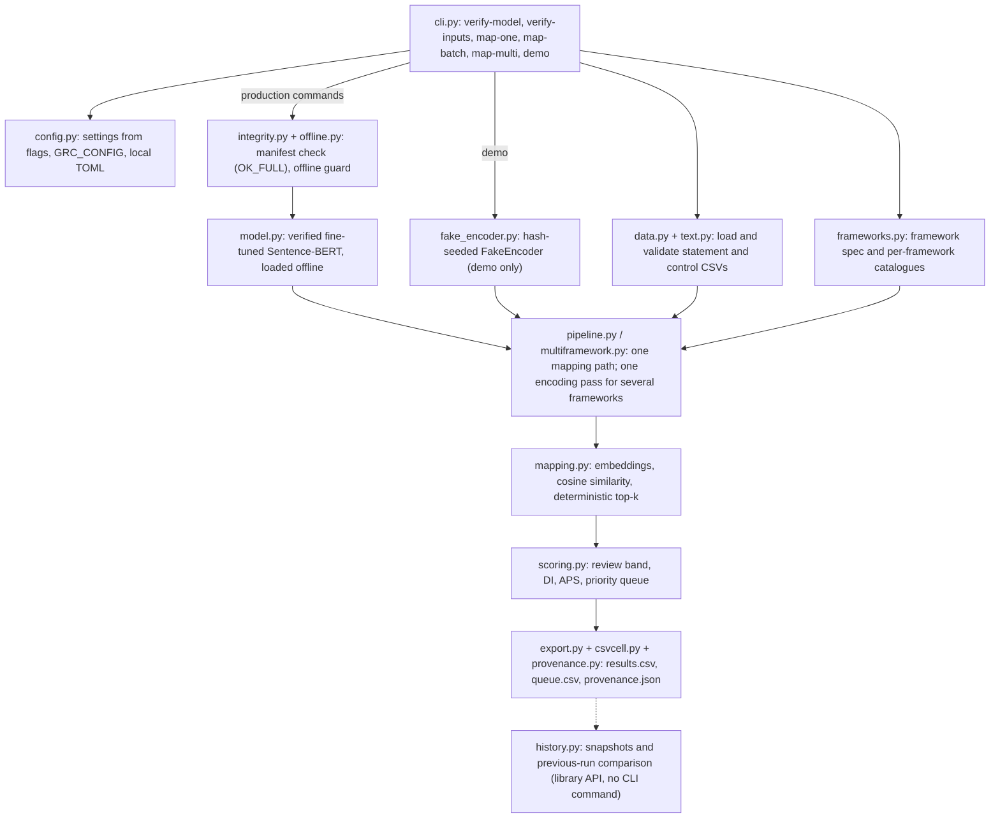

# GRC Multi-Framework Compliance Mapping

Research-pipeline code for an M.Tech dissertation (GRC, NLP). It produces **candidate** mappings from
security-policy statements to framework controls with a fine-tuned Sentence-BERT encoder, so that an
auditor reviews a ranked shortlist instead of searching a whole catalogue by hand.

| Framework | Status |
|---|---|
| ISO/IEC 27001:2022 (93 Annex A controls) | implemented; model fine-tuned on ISO/IEC 27001 policy-control pairs |
| NIST SP 800-53 Rev. 5.2.0 (1,014 active controls) | implemented through `map-multi`; review bands provisional |
| SOC 2 | planned, **not implemented**: no authorised Trust Services Criteria source has been obtained |

For each statement and framework the pipeline reports:

- top-1 and top-3 controls with cosine similarity;
- a heuristic similarity review band: `HIGH` >= 0.59, `REVIEW` >= 0.49 and < 0.59, `ESCALATE` < 0.49;
- DI = 1 - top-1 similarity: the top-1 snapshot dissimilarity (DI_top1; legacy field name
  `drift_index`, historically called the "Drift Index");
- the Audit Priority Score, APS = DI x tier weight (1.00 / 1.25 / 1.50), a heuristic audit-review
  priority score;
- a ranked audit-priority queue.

`map-multi` does the same independently for each framework catalogue in a local spec file (for
example ISO/IEC 27001:2022 and NIST SP 800-53 Rev. 5.2.0). `history.py` compares two compatible runs
(dDI = DI_current - DI_previous).

## Claims boundary

- Every output is a candidate mapping for human review, never a compliance determination.
- Cosine similarity is not a probability; the review bands are heuristic, not probability-calibrated.
- DI is a top-1 snapshot dissimilarity for one run. It does not establish drift over time, policy
  change or non-compliance. DI_mapped (against an independently assigned control) is not implemented.
- APS depends on the top-1 similarity alone; with the default weights its queue order is ascending
  top-1 similarity. It is not a validated or calibrated risk score.
- Review bands outside ISO/IEC 27001 reuse ISO-derived cut-offs provisionally; they are not calibrated
  for that framework, and cross-framework candidates are not a crosswalk.
- SOC 2 is planned but not implemented: no authorised Trust Services Criteria source has been obtained.
- Evaluation figures and their qualifiers are in [docs/RESULTS.md](docs/RESULTS.md).

## Requirements

| Use | Requirements |
|---|---|
| Quick demo (synthetic data, `FakeEncoder`) | Python 3.13 and NumPy (`numpy==2.4.1`, the locked version). Nothing else: no model, no download, no configuration file |
| Unit tests | the above plus `pytest==9.2.0` |
| Production model (`verify-model`, `map-one`, `map-batch`, `map-multi`) | the full pinned environment in [requirements/grc-mvp.lock.txt](requirements/grc-mvp.lock.txt), plus the private fine-tuned model and a local configuration file; see [docs/REPRODUCIBILITY.md](docs/REPRODUCIBILITY.md) |

The quick demo is verified from a fresh clone on Windows PowerShell 5.1 (Python 3.13.11 with NumPy
2.4.1) and on Linux bash (Python 3.13, new virtual environment holding only NumPy 2.4.1). The project
is run from the repository root with `PYTHONPATH=src`; it is not pip-installed.

## Quick start: synthetic demo (Windows PowerShell)

Clone with the URL from the green **Code** button of this GitHub page:

```powershell
git clone https://github.com/<owner>/GRC-MultiFramework-Compliance-Mapping.git
cd GRC-MultiFramework-Compliance-Mapping
```

If your Python 3.13 already has NumPy, skip the next two lines and use `python` below.

```powershell
py -3.13 -m venv "$env:TEMP\grc_demo_venv"
& "$env:TEMP\grc_demo_venv\Scripts\python.exe" -m pip install numpy==2.4.1
```

Run the demo. Output must go outside the repository; the command refuses a folder inside it.

```powershell
$env:PYTHONPATH = "src"
& "$env:TEMP\grc_demo_venv\Scripts\python.exe" -m grc_mapper demo --out "$env:TEMP\grc_demo_output"
```

The JSON result is printed to stdout; the last lines on stderr give the summary and the folder:

```text
DEMO COMPLETE: 12 synthetic statements mapped to 8 synthetic controls; bands {'HIGH': 0, 'REVIEW': 0, 'ESCALATE': 12}
output directory: <TEMP>\grc_demo_output\<run_id>
```

Inspect the newest run:

```powershell
$run = Get-ChildItem "$env:TEMP\grc_demo_output" -Directory | Sort-Object Name | Select-Object -Last 1
Get-ChildItem $run.FullName
Import-Csv (Join-Path $run.FullName "results.csv") | Select-Object statement_id, top1_control_id, top1_similarity, tier_code, drift_index, aps | Format-Table
```

Linux (bash), same steps:

```bash
python3.13 -m venv /tmp/grc_demo_venv && /tmp/grc_demo_venv/bin/python -m pip install numpy==2.4.1
PYTHONPATH=src /tmp/grc_demo_venv/bin/python -m grc_mapper demo --out /tmp/grc_demo_output
```

Each run writes a new folder `<run_id>` (UTC timestamp plus random suffix); the mapping results are
identical from run to run.

## Expected output

| File | Content |
|---|---|
| `results.csv` | one row per statement, in input order |
| `queue.csv` | the same rows with `queue_rank`, highest APS first |
| `provenance.json` | run ID, versions, settings, input hashes, band counts, disclaimers |

`results.csv` (first rows, selected columns):

```text
statement_id,top1_control_id,top1_similarity,tier_code,drift_index,aps_weight,aps,top2_control_id,top3_control_id
DS-001,DEMO-01,0.08106782,ESCALATE,0.91893218,1.50,1.37839828,DEMO-07,DEMO-02
DS-002,DEMO-02,0.05696359,ESCALATE,0.94303641,1.50,1.41455461,DEMO-03,DEMO-04
DS-003,DEMO-08,0.09514005,ESCALATE,0.90485995,1.50,1.35728993,DEMO-01,DEMO-04
```

| Field | Meaning |
|---|---|
| `top1_control_id`, `top1_similarity` | first-ranked control and its cosine similarity |
| `top2_*`, `top3_*` | next candidates |
| `tier_code`, `tier_label` | review band from the top-1 similarity |
| `drift_index` | DI = 1 - top1_similarity (legacy name) |
| `aps_weight`, `aps` | tier weight and APS = drift_index x aps_weight |
| `drift_index_r4`, `aps_r4` | legacy 4-decimal values |
| `n_tokens_full`, `n_tokens_used`, `truncated` | statement length against the 256-token limit |
| `encoder_kind` | `FAKE_SHA256_DEMO` in the demo, `SBERT_PRODUCTION` with the real model |
| `review_status` | always `CANDIDATE_PENDING_HUMAN_REVIEW` |

**The demo is not model evidence.** `FakeEncoder` turns each text into a pseudo-random unit vector
seeded by its SHA-256 hash. Such vectors are nearly orthogonal, so demo similarities sit near 0 and
every demo statement falls in `ESCALATE`. The demo shows that loading, validation, ranking, banding,
DI/APS arithmetic, the queue, export and provenance work end to end. Its scores are not NLP inference
and say nothing about the production model's performance. The synthetic files are described in
[examples/synthetic/README.md](examples/synthetic/README.md).

## Architecture



| Module | Input | Output |
|---|---|---|
| `data.py`, `text.py` | statement CSV (ID, text), control CSV (ID, text) | validated statements and a natural-sort control catalogue |
| `model.py` / `fake_encoder.py` | texts | L2-normalised 384-dimension embeddings and token profiles |
| `mapping.py` | statement and control embeddings | similarity matrix and ranked top-k candidates |
| `scoring.py` | top-k candidates | band, DI, APS and queue order |
| `export.py`, `provenance.py` | scored rows | CSV and JSON files in a new run folder |
| `history.py` | two run snapshots | per-statement dDI, top-1 and band changes, change review queue |

The full module map and exit codes are in [docs/CODE_REVIEW_GUIDE.md](docs/CODE_REVIEW_GUIDE.md); the
method is in [docs/METHODOLOGY.md](docs/METHODOLOGY.md).

## Advanced usage (production model and local research assets)

These commands need the private model and a local configuration file copied from
[config/example.local.toml](config/example.local.toml) to a place outside the repository, then
`$env:GRC_CONFIG = "<path to your copy>"` (or `--config <path>` on any command). Inference runs only
after the model directory passes full-manifest verification (`OK_FULL`) and stays offline.

| Command | Purpose | Main options |
|---|---|---|
| `verify-model` | check the model directory against the manifests | `--load` also loads it offline |
| `verify-inputs` | validate the control and statement CSVs | `--controls`, `--statements`, `--profile generic\|research` |
| `map-one` | map one statement | `--text-file` (recommended), `--stdin` or `--text`; `--statement-id`, `--top-k`, `--out` |
| `map-batch` | map a statement CSV against the configured catalogue | `--statements` (required), `--out` (required, outside the repo), `--controls`, `--top-k`, `--batch-size`, `--device`, `--include-text` |
| `map-multi` | map one statement CSV against several frameworks | `--statements`, `--frameworks` (local spec JSON), `--out` (all required); `--select-column` with `--select-value`, `--only`, `--top-k`, `--batch-size`, `--device` |
| `demo` | synthetic pipeline demonstration | `--out` |

Common options: `--config`, `-v` / `-vv`. Statement CSVs use the columns set in the configuration
(built-in default `Statement_ID`, `Statement_Text`).

```powershell
$env:PYTHONPATH = "src"
python -m grc_mapper verify-model --load
python -m grc_mapper map-one --text-file statement.txt
python -m grc_mapper map-batch --statements statements.csv --out "$env:TEMP\grc_runs"
python -m grc_mapper map-multi --statements statements.csv --frameworks frameworks.json --out "$env:TEMP\grc_runs"
```

Exit codes: 0 ok; 1 unexpected; 2 configuration or usage; 3 integrity; 4 input; 5 model; 6 write
failure; 7 verification incomplete (`verify-model` only).

Tests: `python -m pytest -m unit` needs no private assets; `-m integration` and `-m regression` need
the local model and research files.

## Research scope and limitations

- The synthetic demo exercises the software only. Real mappings need the private production model.
- Production-model in-sample figures are not generalisation results. The cited research figures are
  the cross-validated and out-of-fold ones in [docs/RESULTS.md](docs/RESULTS.md).
- The external real-organisation dataset is unlabelled: results on it are distributions only, with no
  accuracy, precision, recall or F1.
- NIST SP 800-53 uses the ISO-derived cut-offs provisionally; they need independent calibration.
  Similarity scores from different frameworks are not directly comparable, and the NIST-to-ISO
  reference mapping is informative only: it does not establish control equivalence.
- Every mapping needs human review; nothing here is an automatic compliance approval.

Further detail: [docs/LIMITATIONS.md](docs/LIMITATIONS.md), [docs/REPRODUCIBILITY.md](docs/REPRODUCIBILITY.md)
and [docs/DATA_AND_LICENSING.md](docs/DATA_AND_LICENSING.md).

## What this repository does not contain

The research model, ISO control descriptions, policy datasets, notebooks, annotations and
intermediate predictions are kept out of this repository.

## Licence

Pending confirmation of university and co-author permissions. All rights reserved until a licence is added.
Publication of this repository grants no permission to reuse or redistribute the research work.
