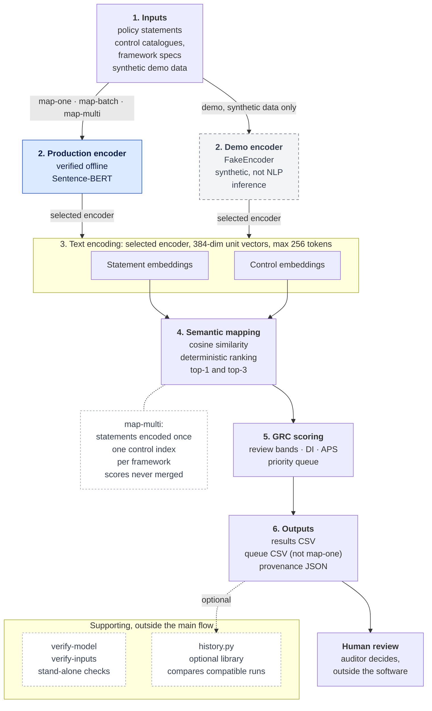

# GRC Multi-Framework Compliance Mapping


Research code from an M.Tech dissertation in cybersecurity. It ranks candidate controls for
security-policy statements against ISO/IEC 27001:2022 and NIST SP 800-53 Rev. 5.2.0 using a
Sentence-BERT encoder fine-tuned on ISO/IEC 27001 policy-control pairs. NIST mappings use this
ISO-trained encoder against the NIST catalogue; the model was not fine-tuned on NIST-specific
policy-control pairs. Each suggestion includes a similarity score, a heuristic review band and an
audit-priority rank to help GRC auditors review a shortlist rather than an entire catalogue.

**Every output is a candidate for human review. Nothing in this repository certifies compliance.**

## Contents

[Overview](#overview) ·
[Framework status](#framework-status) ·
[Key features](#key-features) ·
[Capabilities and limits](#capabilities-and-limits) ·
[Technology stack](#technology-stack) ·
[Repository structure](#repository-structure) ·
[Architecture](#architecture) ·
[Workflow](#end-to-end-workflow) ·
[Requirements](#requirements) ·
[Quick start](#quick-start-synthetic-demo) ·
[Output](#expected-output) ·
[Advanced usage](#advanced-usage-production-model) ·
[Model and similarity](#model-and-similarity-method) ·
[Scoring](#scoring-and-prioritisation) ·
[Results](#research-results) ·
[Human review](#human-review) ·
[Future work](#future-work) ·
[References](#references) ·
[Licence](#licence)

## Overview

### Problem

Mapping an organisation's policy statements to the controls of a security framework is manual,
slow and inconsistent between auditors. A single policy set can hold hundreds of statements, and a
catalogue such as NIST SP 800-53 holds more than a thousand controls. A common GRC workflow records
a "covered / not covered" decision made by a person, with little help in choosing which controls to
compare a statement with first or which mappings deserve the closest review.

### Objectives

1. Rank candidate controls for each policy statement by semantic similarity, using a Sentence-BERT
   model fine-tuned on ISO/IEC 27001:2022 policy-control pairs.
2. Map the same statements independently against more than one framework (ISO/IEC 27001:2022 and
   NIST SP 800-53 Rev. 5.2.0) without merging their scores.
3. Turn similarity into review effort: heuristic review bands, a per-statement dissimilarity score
   (DI) and an audit-priority score (APS) that orders the review queue.
4. Keep every run auditable: model integrity verification, offline inference, deterministic ranking
   and a provenance record for each run.
5. Compare two compatible runs statement by statement to show what changed.

## Framework status

| Framework | Status |
|---|---|
| ISO/IEC 27001:2022 (93 Annex A controls) | **Implemented.** The model is fine-tuned on ISO/IEC 27001 policy-control pairs; review bands derived from out-of-fold analysis |
| NIST SP 800-53 Rev. 5.2.0 (1,014 active controls) | **Implemented** through `map-multi`. Review bands reuse the ISO cut-offs **provisionally**; not calibrated for NIST |
| SOC 2 (Trust Services Criteria) | **Planned, not implemented.** No authorised criteria source has been obtained |
| NIST CSF 2.0 | **Not implemented** |

Framework catalogues are not distributed here: ISO/IEC 27001 control text is copyrighted, and the
NIST catalogue is built locally from NIST's official OSCAL file.

## Key features

- Top-1 and top-3 candidate controls per statement with cosine similarity.
- Heuristic review bands `HIGH` / `REVIEW` / `ESCALATE`.
- DI (top-1 snapshot dissimilarity) and APS (audit-priority score), plus a ranked review queue.
- Multi-framework mapping: statements encoded once, one independent index and queue per framework.
- Model integrity check before inference: 8 runtime files verified by SHA-256 (`OK_FULL`), offline
  loading, `trust_remote_code=False`, re-verification after loading.
- Deterministic ranking: ties broken by catalogue order, one code path for batch and
  single-statement mapping, demo output identical from run to run.
- CSV, JSON and provenance outputs; spreadsheet formula-injection guard on every CSV cell.
- Previous-run comparison (`history.py`) that refuses to compare runs with a different model,
  catalogue, framework version, preprocessing or scoring rules.
- A public synthetic demo that runs in about a second with Python and NumPy only.
- A publication scanner (`tools/check_publishable.py`) that keeps private data out of this repository.

## Capabilities and limits

| The code does | The code does not |
|---|---|
| rank candidate controls by semantic similarity | decide compliance or certify anything |
| flag statements for closer review (bands, APS) | give calibrated probabilities or risk scores |
| report DI as dissimilarity to the top-1 candidate in one run | measure policy drift over time or prove non-compliance |
| map ISO/IEC 27001:2022 and NIST SP 800-53 Rev. 5.2.0 independently | establish equivalence between ISO and NIST controls |
| run a synthetic demo without the model | show the production model's accuracy in that demo |

- Cosine similarity is a candidate-matching score, not a probability of compliance.
- The review bands are heuristic triage bands, not calibrated confidence levels.
- DI = 1 - top-1 similarity is a snapshot measure for one run. DI_mapped (against an independently
  assigned control) is not implemented.
- APS depends on the top-1 similarity alone; with the default weights its queue order equals ascending
  top-1 similarity. It is not a validated or calibrated risk score.
- Scores from different frameworks are not directly comparable, and the NIST-to-ISO reference mapping
  used in the research is informative only.

Full list: [docs/LIMITATIONS.md](docs/LIMITATIONS.md).

## Technology stack

| Area | Tools |
|---|---|
| Language | Python 3.13 |
| Model | Sentence-BERT (`all-MiniLM-L6-v2`, fine-tuned) via `sentence-transformers` 5.3.0, `transformers` 5.3.0, `tokenizers` 0.22.2, `safetensors` 0.8.0 |
| Compute | PyTorch 2.10.0 (CPU by default; CUDA 13.0 build in the lock) |
| Numerics | NumPy 2.4.1 (the only package the demo needs) |
| Tests | pytest 9.2.0 |
| Environment | exact pins in [requirements/grc-mvp.lock.txt](requirements/grc-mvp.lock.txt) |

## Repository structure

Generated from `git ls-files`: 54 tracked files in 13 directories.

```text
GRC-MultiFramework-Compliance-Mapping/
├── .gitattributes                              line-ending rules: LF for source, docs, config and data files
├── .gitignore                                  keeps local assets, model files, datasets, outputs and caches out of Git
├── README.md                                   this file
├── config/                                     configuration template
│   └── example.local.toml                      template for the private local configuration; copy it outside the repository
├── docs/                                       project documentation
│   ├── CODE_REVIEW_GUIDE.md                    module map, exit codes and suggested review focus
│   ├── DATA_AND_LICENSING.md                   what is and is not distributed; licensing status
│   ├── LIMITATIONS.md                          known limitations of the method and the results
│   ├── METHODOLOGY.md                          what the code computes, step by step
│   ├── REPRODUCIBILITY.md                      environment, local configuration, determinism, comparing runs
│   └── RESULTS.md                              research figures with their evaluation context
├── examples/                                   public example inputs
│   └── synthetic/                              invented demo data; not research data
│       ├── README.md                           describes the synthetic demo files
│       ├── demo_controls.csv                   8 invented controls, DEMO-01 to DEMO-08
│       └── demo_statements.csv                 12 invented statements, DS-001 to DS-012
├── manifests/                                  public model manifest
│   └── model_runtime_manifest.json             path, size and SHA-256 of the 8 runtime model files (no weights)
├── pyproject.toml                              project metadata and pytest settings; the package is not pip-installed
├── requirements/                               environment pins
│   └── grc-mvp.lock.txt                        fully pinned environment for the production model
├── src/                                        source code
│   └── grc_mapper/                             the Python package (run with PYTHONPATH=src)
│       ├── __init__.py                         package marker and version
│       ├── __main__.py                         entry point for python -m grc_mapper
│       ├── cli.py                              commands: verify-model, verify-inputs, map-one, map-batch, map-multi, demo
│       ├── config.py                           settings from flags, GRC_CONFIG and local TOML; bands and weights
│       ├── csvcell.py                          CSV formula-injection guard used by every CSV writer
│       ├── data.py                             loads and validates statement and control CSVs; natural-sort catalogue
│       ├── errors.py                           error types and CLI exit codes
│       ├── export.py                           writes result and queue CSVs and JSON; refuses output inside the repo
│       ├── fake_encoder.py                     hash-seeded FakeEncoder for the demo; no model, no semantics
│       ├── frameworks.py                       framework spec files; per-framework catalogue, bands and weights
│       ├── history.py                          run snapshots and previous-run comparison (dDI)
│       ├── integrity.py                        SHA-256 manifest verification (OK_FULL) and post-load re-check
│       ├── logging_setup.py                    stderr logging with a redaction filter
│       ├── mapping.py                          embedding checks, cosine similarity, deterministic top-k
│       ├── model.py                            verified offline loading of the Sentence-BERT model; token profiles
│       ├── multiframework.py                   one encoding pass, independent mapping per framework
│       ├── offline.py                          offline environment variables and socket guard
│       ├── pipeline.py                         load_encoder; control index; shared mapping path (map-one, map-batch, demo)
│       ├── provenance.py                       run record (provenance.json) and disclaimers
│       ├── scoring.py                          review band, DI, APS and priority queue
│       ├── text.py                             text validation (text unchanged) and the TokenProfile type
│       └── textio.py                           reads one statement for map-one (--text-file, --stdin, --text)
├── tests/                                      automated tests (pytest; markers by folder)
│   ├── _support.py                             shared test helpers, including an isolated test encoder
│   ├── conftest.py                             assigns unit / integration / regression markers by folder; fixtures
│   ├── integration/                            need the local production model and configuration
│   │   ├── test_cli_end_to_end.py              CLI commands end to end with the real model
│   │   ├── test_model_and_pipeline.py          model verification, loading and mapping on research data
│   │   └── test_multiframework_integration.py  map-multi with the real model and framework catalogues
│   ├── regression/                             need the local research files
│   │   └── test_research_regression.py         reproduces the historical research outputs (R-1 to R-7)
│   └── unit/                                   no model and no private data needed
│       ├── test_cli_export_provenance.py       text input, FakeEncoder, logging, export, provenance, CLI
│       ├── test_core_modules.py                errors, offline guard, integrity, data loading, text, model loader
│       ├── test_csv_safety.py                  formula-injection guard and CSV quoting of awkward values
│       ├── test_mapping_scoring_pipeline.py    config, similarity, ranking, bands, DI/APS, pipeline
│       ├── test_multiframework_history.py      framework specs, multi-framework mapping, run comparison
│       ├── test_publication_scanner.py         publication scanner checks on temporary trees
│       ├── test_repository.py                  repository hygiene: lock, manifest, examples, no downloads
│       └── test_validate_env_rules.py          environment-validator rules and lock parsing
└── tools/                                      maintenance tools
    ├── check_publishable.py                    fail-closed publication scanner (checks S1 to S8)
    └── validate_env.py                         validator for the locked environment (checks V0 to V4)
```

Not in the repository, by design: the model weights, policy datasets, framework catalogues,
research notebooks and run outputs. Outputs are always written outside the repository; the code
refuses an output folder inside it.

## Architecture

Each mapping command loads and validates its inputs, selects the appropriate encoder, and passes the
data to the shared mapping pipeline. Verification commands perform their respective checks
independently. The production and demo mapping paths share the validation, mapping, scoring and
export logic, but use different encoders. The demo path never loads the model.



Blue: production inference with the private model. Grey dashed: public demo; FakeEncoder vectors carry
no meaning. Dotted nodes: notes, stand-alone checks and the optional history library, outside the main flow.

## End-to-end workflow

1. **Load and validate.** `data.py` reads the statement and control CSVs, checks IDs, columns,
   duplicates and expected counts, and sorts controls in natural order (A.5.2 before A.5.10).
   `map-multi` reads a framework spec (`frameworks.py`) with one catalogue per framework.
2. **Choose the encoder.** Production commands: `integrity.py` verifies the model directory
   (`OK_FULL`), `offline.py` blocks network access and `model.py` loads the fine-tuned model offline.
   Demo: `FakeEncoder`, with no model at all.
3. **Prepare text.** Inside `pipeline.py` (or `multiframework.py`), `text.py` validates each text and
   passes it on unchanged; no stemming or rewriting. The active encoder gives each text a token
   profile against the 256-token limit.
4. **Encode and map.** The active encoder produces 384-dimension unit vectors (pseudo-random for the
   demo). `mapping.py` computes cosine similarity (dot product of unit vectors), ranks every control
   and keeps the top 3. `map-multi` builds one index per framework and encodes statements once.
5. **Score.** `scoring.py` assigns the review band, DI, APS and the queue order.
6. **Export.** `export.py` writes the results as CSV (through `csvcell.py`), plus a queue CSV for
   `demo`, `map-batch` and `map-multi`, and `provenance.py` writes the run record as JSON, in a new run
   folder outside the repository. `map-one` prints its result and saves files only with `--out`.
7. **Review.** An auditor works through `queue.csv` from the top and decides each mapping.
8. **Compare (optional).** `history.py` compares two compatible runs statement by statement.

## Requirements

| Use | You need |
|---|---|
| Quick demo (synthetic data, FakeEncoder) | Python 3.13 and NumPy 2.4.1. No model, no download, no configuration file |
| Unit tests | the above plus pytest 9.2.0 |
| Production model (`verify-model`, `map-one`, `map-batch`, `map-multi`) | the full environment in [requirements/grc-mvp.lock.txt](requirements/grc-mvp.lock.txt), the private fine-tuned model and a local configuration file ([docs/REPRODUCIBILITY.md](docs/REPRODUCIBILITY.md)) |

The quick demo is verified from a fresh GitHub clone on Windows PowerShell 5.1 (Python 3.13.11 with
NumPy 2.4.1) and on Linux bash (Python 3.13, new virtual environment holding only NumPy 2.4.1). The
project runs from the repository root with `PYTHONPATH=src`; it is not pip-installed.

## Quick start: synthetic demo

Windows PowerShell. Clone with the URL from the green **Code** button of this GitHub page:

```powershell
git clone https://github.com/<owner>/GRC-MultiFramework-Compliance-Mapping.git
cd GRC-MultiFramework-Compliance-Mapping
```

If your Python 3.13 already has NumPy, skip the next two lines and use `python` below.

```powershell
py -3.13 -m venv "$env:TEMP\grc_demo_venv"
& "$env:TEMP\grc_demo_venv\Scripts\python.exe" -m pip install numpy==2.4.1
```

Run the demo. Output must go outside the repository; the command refuses a folder inside it.

```powershell
$env:PYTHONPATH = "src"
& "$env:TEMP\grc_demo_venv\Scripts\python.exe" -m grc_mapper demo --out "$env:TEMP\grc_demo_output"
```

The JSON result is printed to stdout; the last lines on stderr give the summary and the folder:

```text
DEMO COMPLETE: 12 synthetic statements mapped to 8 synthetic controls; bands {'HIGH': 0, 'REVIEW': 0, 'ESCALATE': 12}
output directory: <TEMP>\grc_demo_output\<run_id>
```

Inspect the newest run:

```powershell
$run = Get-ChildItem "$env:TEMP\grc_demo_output" -Directory | Sort-Object Name | Select-Object -Last 1
Get-ChildItem $run.FullName
Import-Csv (Join-Path $run.FullName "results.csv") | Select-Object statement_id, top1_control_id, top1_similarity, tier_code, drift_index, aps | Format-Table
```

Linux (bash), same steps:

```bash
python3.13 -m venv /tmp/grc_demo_venv && /tmp/grc_demo_venv/bin/python -m pip install numpy==2.4.1
PYTHONPATH=src /tmp/grc_demo_venv/bin/python -m grc_mapper demo --out /tmp/grc_demo_output
```

Each run writes a new folder `<run_id>` (UTC timestamp plus random suffix); the mapping results are
identical from run to run.

## Expected output

| File | Content |
|---|---|
| `results.csv` | one row per statement, in input order |
| `queue.csv` | the same rows with `queue_rank`, highest APS first |
| `provenance.json` | run ID, versions, settings, input hashes, band counts, disclaimers |

`results.csv` (first rows, selected columns):

```text
statement_id,top1_control_id,top1_similarity,tier_code,drift_index,aps_weight,aps,top2_control_id,top3_control_id
DS-001,DEMO-01,0.08106782,ESCALATE,0.91893218,1.50,1.37839828,DEMO-07,DEMO-02
DS-002,DEMO-02,0.05696359,ESCALATE,0.94303641,1.50,1.41455461,DEMO-03,DEMO-04
DS-003,DEMO-08,0.09514005,ESCALATE,0.90485995,1.50,1.35728993,DEMO-01,DEMO-04
```

| Field | Meaning |
|---|---|
| `top1_control_id`, `top1_similarity` | first-ranked control and its cosine similarity |
| `top2_*`, `top3_*` | next candidates |
| `tier_code`, `tier_label` | review band from the top-1 similarity |
| `drift_index` | DI = 1 - top1_similarity (legacy name) |
| `aps_weight`, `aps` | tier weight and APS = drift_index x aps_weight |
| `drift_index_r4`, `aps_r4` | legacy 4-decimal values |
| `n_tokens_full`, `n_tokens_used`, `truncated` | statement length against the 256-token limit |
| `encoder_kind` | `FAKE_SHA256_DEMO` in the demo, `SBERT_PRODUCTION` with the real model |
| `review_status` | always `CANDIDATE_PENDING_HUMAN_REVIEW` |

`map-multi` adds `framework_id` and `framework_version` to every row and writes one results file and
one queue file per framework, plus `statements.csv`, `excluded.csv` and `rejected.csv`.

**The demo is not model evidence.** `FakeEncoder` turns each text into a pseudo-random unit vector
seeded by its SHA-256 hash. Such vectors are nearly orthogonal, so demo similarities sit near 0 and
every demo statement falls in `ESCALATE`. The demo shows that loading, validation, ranking, banding,
DI/APS arithmetic, the queue, export and provenance work end to end. Its scores are not NLP inference
and say nothing about the production model's performance. The synthetic files are described in
[examples/synthetic/README.md](examples/synthetic/README.md).

## Advanced usage: production model

These commands need the private model and a local configuration file copied from
[config/example.local.toml](config/example.local.toml) to a place outside the repository, then
`$env:GRC_CONFIG = "<path to your copy>"` (or `--config <path>` on any command). Inference runs only
after the model directory passes full-manifest verification (`OK_FULL`) and stays offline.

| Command | Purpose | Main options |
|---|---|---|
| `verify-model` | check the model directory against the manifests | `--load` also loads it offline |
| `verify-inputs` | validate the control and statement CSVs | `--controls`, `--statements`, `--profile generic\|research` |
| `map-one` | map one statement | `--text-file` (recommended), `--stdin` or `--text`; `--statement-id`, `--top-k`, `--out` |
| `map-batch` | map a statement CSV against the configured catalogue | `--statements` (required), `--out` (required, outside the repo), `--controls`, `--top-k`, `--batch-size`, `--device`, `--include-text` |
| `map-multi` | map one statement CSV against several frameworks | `--statements`, `--frameworks` (local spec JSON), `--out` (all required); `--select-column` with `--select-value`, `--only`, `--top-k`, `--batch-size`, `--device` |
| `demo` | synthetic pipeline demonstration | `--out` |

Common options: `--config`, `-v` / `-vv`. Statement CSVs use the columns set in the configuration
(built-in default `Statement_ID`, `Statement_Text`).

```powershell
$env:PYTHONPATH = "src"
python -m grc_mapper verify-model --load
python -m grc_mapper map-one --text-file statement.txt
python -m grc_mapper map-batch --statements statements.csv --out "$env:TEMP\grc_runs"
python -m grc_mapper map-multi --statements statements.csv --frameworks frameworks.json --out "$env:TEMP\grc_runs"
```

Exit codes: 0 ok; 1 unexpected; 2 configuration or usage; 3 integrity; 4 input; 5 model; 6 write
failure; 7 verification incomplete (`verify-model` only).

Tests: `python -m pytest -m unit` needs no private assets; `-m integration` and `-m regression` need
the local model and research files.

## Model and similarity method

- **Encoder:** `all-MiniLM-L6-v2` fine-tuned with Multiple Negatives Ranking Loss on 206 research
  policies paired with ISO/IEC 27001:2022 controls. Mean pooling, L2 normalisation, 384 dimensions,
  maximum sequence length 256 tokens. The weights are private and not distributed.
- **Inputs:** statement and control texts are encoded verbatim. Longer texts are truncated at 256
  tokens and flagged (`truncated`).
- **Similarity:** dot product of unit-norm embeddings (equal to cosine similarity), accumulated in
  float64. Candidates are ranked by similarity, ties broken by catalogue order; nothing is rounded
  before ranking.
- **Integrity:** inference runs only after the model directory matches its manifests (`OK_FULL`),
  with network access blocked and files re-hashed after loading.

Full method: [docs/METHODOLOGY.md](docs/METHODOLOGY.md).

## Scoring and prioritisation

| Quantity | Definition | Reading |
|---|---|---|
| Review band | `HIGH` if sim >= 0.59, `REVIEW` if 0.49 <= sim < 0.59, `ESCALATE` if sim < 0.49 | heuristic triage band, not a confidence level |
| DI (`drift_index`) | 1 - top-1 similarity | dissimilarity to the top-1 candidate in this run |
| APS (`aps`) | DI x tier weight (`HIGH` 1.00, `REVIEW` 1.25, `ESCALATE` 1.50) | heuristic audit-priority score |
| Queue | descending APS, then ascending similarity, then statement ID | review order, highest priority first |
| dDI (`history.py`) | DI in the current run - DI in a previous compatible run | change between two runs, not policy drift |

`drift_index` is a legacy output-column name for DI. It measures dissimilarity to the top-1 candidate in a single run; it does not measure temporal policy drift.

The 0.59 / 0.49 cut-offs come from the out-of-fold analysis of the ISO model (F1-optimal threshold
0.50 plus fixed offsets). For NIST SP 800-53 they are reused provisionally and need independent
calibration.

## Research results

Figures come from the research notebooks and this repository's validation runs. Each line names
its evaluation type; they are separate experiments and must not be combined.
Full tables and qualifiers: [docs/RESULTS.md](docs/RESULTS.md).

| Evaluation | Result | Context |
|---|---|---|
| Zero-shot baseline, `all-MiniLM-L6-v2` (206 policies) | exact 28.6%, top-3 51.0% | no training |
| Fine-tuned, 5-fold cross-validation | exact **39.9% +/- 12.5%**, top-3 **65.1% +/- 3.5%** (zero-shot k-fold mean 28.8% / 51.0%); paired t-test p = 0.0145 | single unseeded run; part of the gain comes from 17 templated rows |
| Fine-tuned, pooled out-of-fold | exact 40.8% (84/206); AUC of top-1 similarity for correctness 0.6673 | source of the review-band cut-offs |
| Production model, in-sample | exact 56.3%, top-3 82.5% | scored on its own training policies; **not a generalisation result** |
| External real-organisation statements (6,104) | ISO bands 707 / 1,495 / 3,902; NIST bands 672 / 2,107 / 3,325 | **unlabelled**: distributions only, no accuracy claim; NIST bands provisional |

Inter-annotator agreement on the labelled set: Cohen's kappa 0.5824 on 30 policies.

## Human review

Human review is mandatory before any mapping is accepted.

- Start at the top of `queue.csv`: low-similarity, high-APS statements come first.
- Check the top-1 control against the statement, then the top-2 and top-3 alternatives; a statement
  can map to several controls or to none.
- Treat `HIGH` as "probably the right area", not as "correct"; out-of-fold, about half of `HIGH`
  top-1 candidates were exact matches.
- Record the decision (accept, reject or reassign) outside this tool. Every row stays
  `CANDIDATE_PENDING_HUMAN_REVIEW`; the software never marks anything compliant.

## Future work

- SOC 2 mapping once an authorised Trust Services Criteria source is available.
- Calibrated review bands for NIST SP 800-53 from an independently labelled sample.
- Labelled evaluation on the external real-organisation statements.
- DI against independently assigned controls (DI_mapped), for example from a Statement of
  Applicability.

## References

- N. Reimers and I. Gurevych, "Sentence-BERT: Sentence Embeddings using Siamese BERT-Networks", EMNLP-IJCNLP 2019.
- `sentence-transformers/all-MiniLM-L6-v2` model card, Hugging Face.
- ISO/IEC 27001:2022, *Information security, cybersecurity and privacy protection: Information security management systems: Requirements*.
- NIST SP 800-53 Rev. 5, *Security and Privacy Controls for Information Systems and Organizations* (catalogue release 5.2.0, OSCAL format).
- NIST, informative mapping of SP 800-53 Rev. 5 to ISO/IEC 27001:2022 (2023), used for reference only.

Further documents: [docs/METHODOLOGY.md](docs/METHODOLOGY.md), [docs/RESULTS.md](docs/RESULTS.md),
[docs/LIMITATIONS.md](docs/LIMITATIONS.md), [docs/REPRODUCIBILITY.md](docs/REPRODUCIBILITY.md),
[docs/DATA_AND_LICENSING.md](docs/DATA_AND_LICENSING.md), [docs/CODE_REVIEW_GUIDE.md](docs/CODE_REVIEW_GUIDE.md).

## What this repository does not contain

The research model, ISO control descriptions, policy datasets, notebooks, annotations and
intermediate predictions are kept out of this repository.

## Licence

Pending confirmation of university and co-author permissions. All rights reserved until a licence is added.
Publication of this repository grants no permission to reuse or redistribute the research work.
